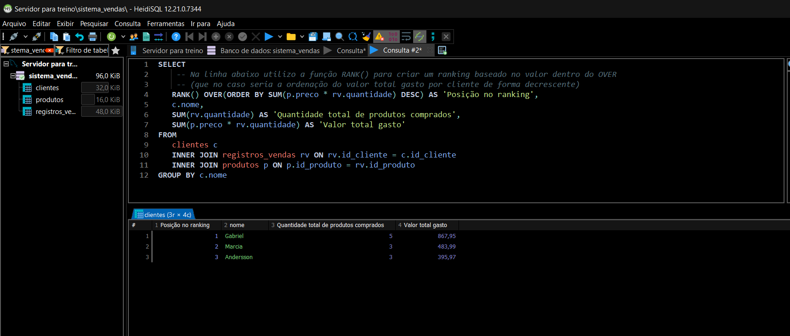

## Exemplo dos treinos



<br>

## Organização do projeto

O projeto está organizado em diretórios que separam os exercícios práticos, as consultas SQL principais e os materiais de documentação.

```text
Treino-MySQL/
│
├── Docs/
│   └── print-e15.png
│
├── Exercicios/
│   ├── 01-Queries/
│   ├── 02-Views/
│   ├── 03-Procedures/
│   └── 04-Triggers/
│
├── Queries Primarias (Principais)/
│   ├── CREATES/
│   ├── INSERTS/
│   ├── SELECTS/
│   └── CREATE-DATABASE.sql
│
└── README.md
```

### Descrição dos diretórios e arquivos

- **`Docs/`**: armazena imagens utilizadas na documentação do projeto.
  - `print-e15.png`: imagem de exemplo dos exercícios.

- **`Exercicios/`**: reúne os exercícios práticos desenvolvidos durante os estudos de MySQL.
  - `01-Queries/`: exercícios envolvendo consultas SQL.
  - `02-Views/`: exercícios de criação e utilização de views.
  - `03-Procedures/`: exercícios de criação e execução de procedures.
  - `04-Triggers/`: exercícios de criação e utilização de triggers.

- **`Queries Primarias (Principais)/`**: contém os scripts SQL fundamentais para estruturar e consultar o banco de dados.
  - `CREATES/`: scripts para criação de tabelas e estruturas do banco.
  - `INSERTS/`: scripts para inserção de dados nas tabelas.
  - `SELECTS/`: consultas SQL utilizadas para recuperar e analisar dados.
  - `CREATE-DATABASE.sql`: script para criação do banco de dados.

- **`README.md`**: apresenta o projeto e explica sua organização.

🔗 **Repositório:** [Treino-MySQL](https://github.com/trevisaq/Treino-MySQL/)
